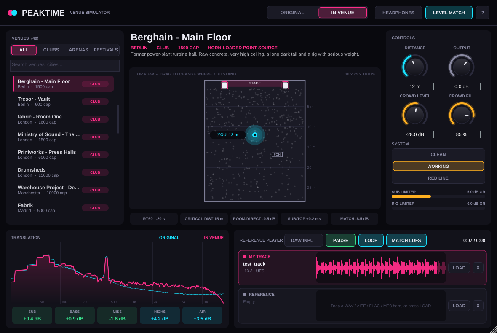

# PeakTime - venue simulator

**Hear your track on a club system, from your studio.**

PeakTime plays your music through a model of a real room: the sound system in it, the
crowd standing in it and the distance between you and the stage. Step through 40 clubs,
arenas and festivals - Pacha, Stereo Montreal, Space, Berghain, fabric, Ministry of Sound,
DC-10, Coda, Printworks, Tomorrowland and more - and find out whether a mix travels or only
works in one kind of room.



Formats: **VST3, AU and a standalone app** (macOS Apple Silicon + Intel, Windows x64).

---

## What it does

| Control | What it changes |
|---|---|
| **Venue** | Each venue arrives set up: room size, surfaces, reverb time, rig type, sub tuning, mono/stereo install, crowd size and a typical listening spot. |
| **Distance** | Where you stand, in metres. Drag yourself on the floor plan. Up close it's mostly the rig; further back the reflections arrive later and louder, air absorbs the top end, the crowd gets in the way and subs/tops drift out of time alignment. |
| **Crowd level / fill** | How loud the crowd is against the system, and how many bodies are in the room. Bodies absorb highs and shorten the reverb, so a full room is a different space - not just quieter. |
| **System** | Clean, Working or Red line. Drives the rig into its sub limiter, rig limiter, amp clipping and horn distortion, like a busy night. |
| **Original / In venue** | The A/B. With **Level match** on, both play at the same loudness, so you hear what disappears, what turns to mud and what survives. |
| **Headphones** | Adds room crossfeed (both ears hear both stacks) so the simulation doesn't sit inside your head. |
| **Translation panel** | Live spectrum of Original vs In venue, plus how much Sub / Bass / Mids / Highs / Air you gain or lose where you're standing. |

### Referencing your songs
The **Reference player** has two slots: **MY TRACK** and **REFERENCE**. Drag in a WAV / AIFF /
FLAC / MP3 bounce (or press LOAD). Both slots share one playhead, the reference is
loudness-matched (LUFS) to your track, and both play through the same venue - so you compare
like with like. Click a slot to switch, click the waveform to jump. Switch back to
**DAW INPUT** to hear whatever is playing in your session. It works in the standalone app too:
no DAW needed.

> Put PeakTime **last on your master**, and bypass it before you export.

### How the venues are modelled
Each room is built from its size, surfaces and reverb time (image-source early reflections +
a per-octave diffuse tail scaled to the room's critical distance), its sound system (crossover,
sub tuning, horn character, limiters, mono/stereo install, sub/top alignment set at FOH),
air absorption over distance and the crowd. The numbers are acoustic estimates from public
information, not official measurements, and PeakTime isn't affiliated with any venue.

---

## Getting the installers (GitHub)

You don't need to compile anything on your computer - GitHub builds the installers for you.

1. **Create a repo**: on github.com click **New repository**, name it `PeakTime`, and create it.
2. **Upload the files**: unzip the project, then on the repo page click **Add file > Upload files**
   and drag in *everything inside* the `PeakTime` folder (including the `.github` folder).
   - On a Mac the `.github` folder is hidden. In Finder press **Cmd + Shift + .** to show it.
   - Commit the upload.
3. **Build**: go to the **Actions** tab, pick **Build PeakTime installers**, press **Run workflow**.
   It takes about 10-15 minutes.
4. **Download**: open the finished run and download **PeakTime-macOS** (`.pkg`) or
   **PeakTime-Windows** (`.exe`) at the bottom of the page.

**Optional - a proper Release page:** go to **Releases > Draft a new release**, type a tag like
`v1.0.0`, and publish. The workflow builds both installers and attaches them to the release
automatically.

## Installing

**macOS** - double-click `PeakTime-1.0.0-macOS.pkg`.
The installer isn't notarised, so the first time macOS may block it: right-click the `.pkg` >
**Open**, or go to **System Settings > Privacy & Security** and click **Open Anyway**.
Installs to:
- VST3: `/Library/Audio/Plug-Ins/VST3/PeakTime.vst3`
- AU: `/Library/Audio/Plug-Ins/Components/PeakTime.component`
- App: `/Applications/PeakTime.app`

**Windows** - run `PeakTime-1.0.0-Windows-Setup.exe`. If SmartScreen appears, click
**More info > Run anyway**. Installs to:
- VST3: `C:\Program Files\Common Files\VST3\PeakTime.vst3`
- App: `C:\Program Files\PeakTime\PeakTime.exe`

**Ableton Live** - Settings > **Plug-Ins** > turn on **Use VST3 Plug-In System Folders**
(and **Use Audio Units** on Mac) > **Rescan**. PeakTime appears under Plug-Ins > PeakTime Audio.

## Updating

Change the version in `CMakeLists.txt` (`project(PeakTime VERSION 1.0.1 ...)`), upload it, and
run the workflow again (or publish a release tagged `v1.0.1`). The new installer is named with
its version (`PeakTime-1.0.1-...`) and installs straight over the old one - no need to uninstall.

---

## Building locally (optional)

```bash
cmake -B build -DCMAKE_BUILD_TYPE=Release
cmake --build build --config Release
```
CMake downloads JUCE 8 automatically. Developer tests:
`-DPEAKTIME_BUILD_TESTS=ON` (DSP engine, no JUCE) and `-DPEAKTIME_HOST_TEST=ON`
(headless host that runs every venue and renders a UI screenshot).

Built with [JUCE](https://juce.com) (personal-use licence).
